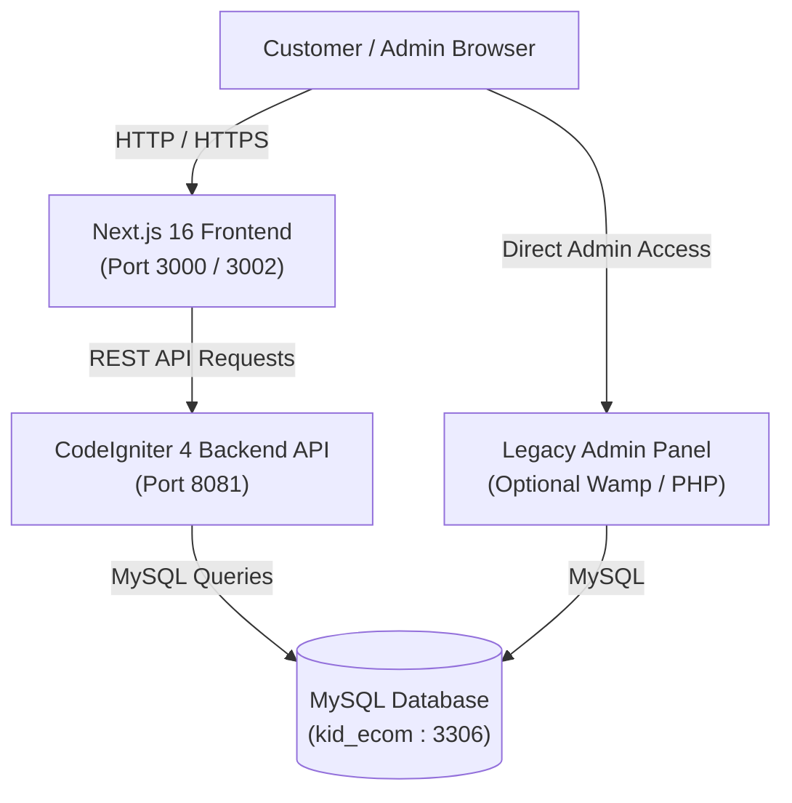

# Chhotu Fashion - Kids E-Commerce Platform

A modern, full-stack e-commerce web application for children's fashion, featuring a Next.js 16 (React 19) storefront & admin portal and a robust CodeIgniter 4 RESTful API backend.

---

## 🏗️ System Architecture



---

## 🧰 Tech Stack

### Frontend (`kids_ecom_nextjs/`)
- **Framework:** Next.js 16 (App Router, Turbopack)
- **UI Library:** React 19, TypeScript
- **Styling:** Custom Modern CSS with CSS Variables & Responsive Layouts
- **Features:**
  - Dynamic Product Catalog & Category Filtering (Girls, Boys, Baby, Festive, Western, Footwear)
  - Size Picker & Variant Selector
  - Persistent Shopping Cart & Wishlist
  - Dynamic Search & Multi-criteria Sorting
  - Customer Authentication (JWT & LocalStorage)
  - Order Tracking & Coupon Redemption System
  - Complete Built-in Admin Dashboard (`/admin`)

### Backend (`backend/`)
- **Framework:** CodeIgniter 4 (PHP 8.2+)
- **Database:** MySQL (Database: `kid_ecom`)
- **Authentication:** Shield / Custom JWT Token Auth
- **APIs:**
  - Public Storefront Endpoints (`/api/products`, `/api/categories`, `/api/reviews`)
  - Customer Endpoints (`/api/cart`, `/api/wishlist`, `/api/orders`, `/api/track`)
  - Admin Endpoints (`/api/admin/products`, `/api/admin/orders`, `/api/admin/media`, `/api/admin/analytics`)
  - CORS-enabled for local development (`localhost:3000`, `localhost:3001`, `localhost:3002`, `localhost:3003`)

---

## 📁 Repository Structure

```
kids_ecom/
├── backend/                  # CodeIgniter 4 RESTful API Backend
│   ├── app/
│   │   ├── Config/          # Routes, Cors, Database, Filters
│   │   ├── Controllers/Api/ # Storefront & Admin API Controllers
│   │   ├── Database/        # Database Migrations & Seeds
│   │   └── Models/          # CI4 Data Models
│   ├── public/              # Public web root (index.php, static uploads)
│   ├── .env.example         # Backend environment template
│   └── spark                # CodeIgniter CLI tool
│
├── kids_ecom_nextjs/         # Next.js 16 Storefront & Admin App
│   ├── src/
│   │   ├── app/             # Next.js App Router (Storefront, Cart, Checkout, Admin)
│   │   ├── components/      # Reusable UI Components (Header, Footer, Modals)
│   │   ├── utils/           # API fetch helpers & Image resolvers
│   │   └── types/           # TypeScript interfaces
│   ├── public/              # Static public assets and product images
│   ├── .env.example         # Frontend environment template
│   └── package.json         # Frontend dependencies and scripts
│
├── admin/                    # Standalone PHP Admin Panel (Optional)
├── images/                   # Product & Media Image Assets
├── .gitignore                # Root gitignore protecting secrets & build artifacts
├── package.json              # Root scripts runner
└── README.md                 # Complete documentation
```

---

## 🚀 Getting Started

### Prerequisites
- **PHP:** 8.2 or higher
- **Node.js:** 18.x or 20.x+
- **Composer:** PHP Dependency Manager
- **MySQL / MariaDB:** e.g., via WampServer, XAMPP, or standalone

---

### 1. Database Setup

1. Start MySQL (e.g. via WampServer).
2. Create a new database named `kid_ecom`:
   ```sql
   CREATE DATABASE kid_ecom CHARACTER SET utf8mb4 COLLATE utf8mb4_general_ci;
   ```

---

### 2. Backend Setup (`backend/`)

1. Open your terminal in the backend directory:
   ```bash
   cd backend
   ```
2. Create your environment configuration:
   ```bash
   cp .env.example .env
   ```
3. Edit `backend/.env` to confirm database credentials:
   ```ini
   CI_ENVIRONMENT = development
   app.baseURL = 'http://localhost:8081'

   database.default.hostname = localhost
   database.default.database = kid_ecom
   database.default.username = root
   database.default.password = 
   database.default.port = 3306
   ```
4. Run migrations using CodeIgniter spark:
   ```bash
   php spark migrate
   ```
5. Start the CodeIgniter development server on port **8081**:
   ```bash
   php spark serve --port 8081
   ```
   *The API will be live at `http://localhost:8081/api`.*

---

### 3. Frontend Setup (`kids_ecom_nextjs/`)

1. In a separate terminal, navigate to the frontend directory:
   ```bash
   cd kids_ecom_nextjs
   ```
2. Install npm dependencies:
   ```bash
   npm install
   ```
3. Create your local environment file:
   ```bash
   cp .env.example .env.local
   ```
   *Ensure `NEXT_PUBLIC_API_URL=http://localhost:8081/api` is configured.*
4. Start the Next.js development server:
   ```bash
   npm run dev
   ```
5. Open your browser:
   - **Storefront:** [http://localhost:3000](http://localhost:3000) (or `http://localhost:3002` if port 3000 is occupied)
   - **Admin Portal:** [http://localhost:3000/admin](http://localhost:3000/admin)

---

## 📦 Production Build Check

To build the Next.js frontend for production:
```bash
cd kids_ecom_nextjs
npm run build
npm run start
```

---

## 🔗 Key API Endpoints

| Method | Endpoint | Description |
|---|---|---|
| `GET` | `/api/products` | Retrieve catalog with pagination & filters |
| `GET` | `/api/products/:id` | Fetch product details & variants |
| `GET` | `/api/categories` | List product categories |
| `POST` | `/api/auth/login` | Customer login |
| `POST` | `/api/auth/register` | Customer registration |
| `GET` | `/api/cart` | Get customer cart items (auth required) |
| `POST` | `/api/cart` | Add item to cart (auth required) |
| `POST` | `/api/orders` | Place a customer order |
| `GET` | `/api/track/:orderId` | Track status of an order |
| `POST` | `/api/auth/admin-login` | Admin login |
| `GET` | `/api/admin/products` | Admin product management (auth required) |
| `POST` | `/api/admin/media/upload`| Admin media upload (auth required) |
